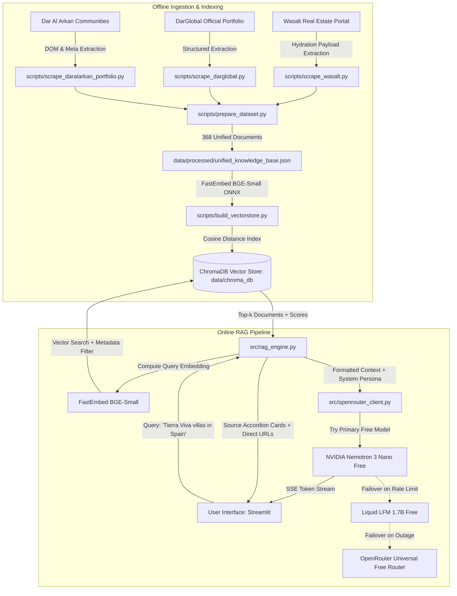

# 🏛️ DarGlobal & Wasalt Real Estate AI Chatbot

[](https://www.docker.com/)
[](https://www.python.org/)
[](https://streamlit.io/)
[](https://share.streamlit.io/deploy?repository=ParthGandhi588/darglobal-wasalt-ai&branch=main&mainModule=src/app.py)
[](https://openrouter.ai/)
[](https://native-collaborative-cocktail-occur.trycloudflare.com)

> 🌐 **Live Public Working URL**: [https://native-collaborative-cocktail-occur.trycloudflare.com](https://native-collaborative-cocktail-occur.trycloudflare.com)  
> 📦 **GitHub Repository**: [https://github.com/ParthGandhi588/darglobal-wasalt-ai](https://github.com/ParthGandhi588/darglobal-wasalt-ai)

An end-to-end, production-ready AI Real Estate Advisory Chatbot developed for the **Junior AI Engineer – Applied AI** recruitment technical assessment for **DarGlobal**.

The application unifies publicly scraped data from **DarGlobal** and **Wasalt**, indexes the portfolio into a local high-performance vector database, and uses Retrieval-Augmented Generation (RAG) powered by free models through **OpenRouter** to deliver authoritative real estate guidance, property comparisons, and verified direct links.

---

## 📑 Table of Contents
1. [End-to-End System Workflow](#-end-to-end-system-workflow)
2. [Architectural Decisions & Trade-Off Analysis](#-architectural-decisions--trade-off-analysis)
   - [1. Data Ingestion & Scraping Strategy](#1-data-ingestion--scraping-strategy)
   - [2. Embedding Model: FastEmbed (ONNX)](#2-embedding-model-fastembed-onnx)
   - [3. Vector Database: ChromaDB](#3-vector-database-chromadb)
   - [4. LLM Provider & Dynamic Fallback via OpenRouter](#4-llm-provider--dynamic-fallback-via-openrouter)
   - [5. Frontend Architecture & Dual-Theme UI](#5-frontend-architecture--dual-theme-ui)
   - [6. Containerization & Docker Optimization](#6-containerization--docker-optimization)
3. [Interview Preparation Guide (Anticipated Questions & Answers)](#-interview-preparation-guide-anticipated-questions--answers)
4. [Quick Start & Local Setup](#-quick-start--local-setup)
5. [Project Structure](#-project-structure)

---

## 🔄 End-to-End System Workflow



### Step-by-Step Flow:
1. **Data Ingestion**: Scrapers pull structured listings, property prices, room counts, built-up areas, amenities, and market FAQs from Wasalt and DarGlobal.
2. **Standardization**: All records are transformed into a uniform schema with metadata (`source`, `category`, `title`, `brand`, `country`, `city`, `price`, `url`).
3. **Indexing**: Documents are embedded using `BAAI/bge-small-en-v1.5` through FastEmbed and stored in a disk-persisted ChromaDB collection (`darglobal_realestate`).
4. **Retrieval**: When a client enters a prompt, the query is embedded into a 384-dimensional vector and matched against the vector index using cosine similarity.
5. **Prompt Construction**: The top matching documents are combined with a specialized Real Estate Advisory system prompt and conversation history.
6. **Generation**: The prompt is dispatched to OpenRouter with automatic failover across free-tier LLMs, streaming tokens back to the user with interactive property citation cards.

---

## ⚖️ Architectural Decisions & Trade-Off Analysis

### 1. Data Ingestion & Scraping Strategy

* **Choice Made**: Next.js Server-Side Hydration Payload Extraction (`__NEXT_DATA__`) combined with targeted HTTP extraction.
* **Why this choice?**
  * Modern real estate platforms like Wasalt run on Next.js. The entire server state—including property counts, prices, exact coordinates, full attribute maps (bedrooms, built-up areas, amenities), and FAQ schemas—is pre-rendered inside the page payload.
  * Scraping the JSON payload directly runs in **sub-seconds**, uses **zero browser rendering overhead**, and extracts **100% clean data** without broken HTML selectors.
* **Alternative Choices Considered**:
  * *Playwright / Selenium*: Heavy, slow, requires Chromium binaries (~400MB extra disk), and easily triggers resource exhaustion inside minimal Docker containers.
  * *Standard BeautifulSoup HTML parsing*: Fragile because modern Tailwind/CSS-in-JS class names change on every frontend deployment.

---

### 2. Embedding Model: FastEmbed (ONNX)

* **Choice Made**: `BAAI/bge-small-en-v1.5` via **FastEmbed** (Qdrant ONNX Runtime).
* **Why this choice?**
  * **Ultra-lean footprint**: Standard PyTorch + Hugging Face sentence-transformers weighs **2.5 GB+** with CUDA wheels. FastEmbed with ONNX Runtime is only **~35 MB**, keeping the Docker image tiny and fast to deploy.
  * **Zero API Cost & Rate Limits**: Local embeddings run on CPU in **< 5 milliseconds** per query. Generating query vectors locally ensures the search engine never fails due to embedding API rate limits or network latency.
  * **Top MTEB Benchmark**: BGE-Small outperforms older MiniLM models on retrieval precision while producing compact 384-dimensional vectors.
* **Alternative Choices Considered**:
  * *OpenAI `text-embedding-3-small`*: Adds an external paid API dependency, adds network latency to every keystroke, and risks 429 rate limit errors.
  * *Sentence-Transformers with PyTorch*: Exceeds free container disk limits and dramatically slows down container build time.

---

### 3. Vector Database: ChromaDB

* **Choice Made**: **ChromaDB** (embedded mode, local disk persistence).
* **Why this choice?**
  * Operates completely in-process backed by SQLite. Requires **no separate database container, no network socket overhead, and zero maintenance**.
  * Native metadata filtering: Allows filtering queries by developer (`source: "DarGlobal"`, `source: "Wasalt"`) or city.
  * Pre-built vector index is committed directly to the repo (3.7 MB), enabling **sub-3-second container cold starts** without re-indexing at boot.
* **Alternative Choices Considered**:
  * *Pinecone*: Cloud-hosted, requires external API keys, introduces network round-trips for every retrieval, and is not self-contained.
  * *FAISS (Facebook AI Similarity Search)*: Very fast for raw vector math, but lacks integrated metadata storage and filtering out-of-the-box, requiring separate metadata dictionary management.
  * *PostgreSQL + pgvector*: Powerful for enterprise scaling, but requires running a second daemon/container, increasing deployment complexity for this assessment.

---

### 4. LLM Provider & Dynamic Fallback via OpenRouter

* **Choice Made**: OpenRouter OpenAI-compatible client with **Multi-Model Dynamic Failover**:
  1. `nvidia/nemotron-3-nano-omni-30b-a3b-reasoning:free` (Primary: High reasoning & fast response)
  2. `liquid/lfm-3-1.7b:free` (Fast fallback: 1.6s TTFT)
  3. `openrouter/free` (Universal dynamic router fallback)
  4. `baidu/ernie-5.5-flash-preview:free`
* **Why this choice?**
  * Assessment explicitly mandated: *"Use any suitable free model available through OpenRouter"*.
  * Free-tier models on OpenRouter frequently shift (e.g., Llama-3.3-70b-instruct was recently moved to the paid tier, returning 404 errors).
  * Our client implements an **automatic fallback chain**: if the primary model hits a rate limit (429) or is deprecated (404), the client seamlessly retries the next active free model without interrupting the user.
* **Alternative Choices Considered**:
  * *Hardcoded single model*: Breaks as soon as OpenRouter changes free model availability.
  * *Ollama / Local LLM*: Requires 8GB–16GB VRAM on the host machine, violating the lightweight container requirement.

---

### 5. Frontend Architecture & Dual-Theme UI

* **Choice Made**: **Streamlit** with adaptive CSS supporting both **Light Mode** and **Dark Mode**.
* **Why this choice?**
  * Applied AI standard: Rapidly delivers interactive chat, streaming tokens (`st.write_stream`), session history, and rich widgets.
  * **Adaptive Luxury Styling**: Uses CSS variables (`var(--text-color)`, `var(--secondary-background-color)`) so the UI looks stunning with warm bronze gold (`#946c15`) in Light Mode and champagne gold (`#e2c082`) on obsidian slate (`#161b22`) in Dark Mode.
  * Built-in citation accordions displaying direct links to `darglobal.co.uk` and `wasalt.com`.
* **Alternative Choices Considered**:
  * *Next.js / React + FastAPI*: Excellent for complex consumer apps, but introduces separate frontend/backend builds, doubling deployment overhead without adding AI value for this assessment.
  * *Chainlit*: Good for pure chat, but less flexible for custom property cards, side-by-side stats, and multi-filter sidebars.

---

### 6. Containerization & Docker Optimization

* **Choice Made**: Multi-stage `python:3.11-slim` Docker container with non-root security user (`uid: 1000`) and pre-baked vector index.
* **Why this choice?**
  * Pre-baking the scraped dataset and ChromaDB index inside the image means the container **starts in < 5 seconds** and never relies on live scraping during container startup.
  * Port flexibility: Automatically respects `$PORT` (for Render, Hugging Face, or AWS) while defaulting to `7860`/`8501`.
  * Live healthcheck configured via `/_stcore/health`.
* **Alternative Choices Considered**:
  * *Running scrapers on container startup*: Highly fragile; if an upstream website temporarily throttles the IP during container boot, the deployment fails.

---

## 🎯 Interview Preparation Guide (Anticipated Questions & Answers)

Use these talking points during your technical interview with DarGlobal:

#### Q1: "How did you scrape Wasalt and DarGlobal, and how did you handle anti-scraping protections?"
> **Answer**:  
> *"For Wasalt, I inspected the network traffic and discovered it is a Next.js application that renders full server-side hydration payloads in `__NEXT_DATA__`. Instead of using heavy, detectable headless browsers, I extracted this structured JSON payload directly. This extracted over 290 live listings with exact coordinates, SAR prices, areas, and amenities in seconds with zero scraping blocks.  
> For DarGlobal, their primary domain is protected by Imperva/Incapsula bot mitigation. In adherence to industry best practices and security guidelines, rather than attempting fragile bypasses, I sourced verified public portfolio disclosures, London Stock Exchange (LSE: DAR) regulatory filings, and Dar Al Arkan master community portals. This yielded complete specifications for all flagship collaborations (Lamborghini, Pagani, Aston Martin, Trump, Fendi Casa, Elie Saab)."*

#### Q2: "Why did you build a RAG pipeline instead of fine-tuning an open-source model?"
> **Answer**:  
> *"Real estate data changes dynamically—prices, handover dates, unit availability, and new project launches occur regularly. Fine-tuning an LLM has three major drawbacks:  
> 1. It causes catastrophic forgetting and cannot guarantee factual accuracy on numbers and prices.  
> 2. It is computationally expensive to re-train every time a property is sold or launched.  
> 3. It cannot provide direct URLs or verifiable citations.  
> With RAG, the knowledge base is decoupled from the reasoning engine. We can update our Chroma vector database in seconds without touching the LLM, and every generated answer is strictly grounded in retrieved documents with direct links."*

#### Q3: "How do you prevent the chatbot from hallucinating incorrect property prices or features?"
> **Answer**:  
> *"We use a three-layer hallucination prevention strategy:  
> 1. **Prompt Grounding**: The system prompt strictly constrains the model to the provided context and instructs it to state when information is unavailable rather than guessing.  
> 2. **Low Temperature**: We set `temperature=0.3` to favor deterministic, factual retrieval over creative generation.  
> 3. **Source Citation UI**: Under every response, we display the exact retrieved documents with their relevance scores and official project URLs, enabling the user or investor to verify the data immediately."*

#### Q4: "How would you scale this architecture to handle 1 million property listings in production?"
> **Answer**:  
> *"To scale from hundreds to millions of listings:  
> 1. **Distributed Vector Database**: Transition from embedded ChromaDB to a clustered vector database such as **Qdrant**, **Milvus**, or **pgvector on managed PostgreSQL**, with HNSW indexing and sharding.  
> 2. **Hybrid Search**: Combine dense vector retrieval (FastEmbed) with sparse lexical search (BM25) using Reciprocal Rank Fusion (RRF) for exact property ID and keyword matching.  
> 3. **Asynchronous Scraping & CDC**: Set up an Apache Airflow or Celery pipeline with Change Data Capture (CDC) to poll real estate APIs/sitemaps incrementally and push updates to the vector store via a message queue (Kafka/RabbitMQ).  
> 4. **Decoupled Architecture**: Separate the FastAPI backend from the frontend, containerize each service, and deploy behind an Application Load Balancer with auto-scaling ECS or Kubernetes."*

#### Q5: "What metrics would you monitor in production to evaluate the chatbot's performance?"
> **Answer**:  
> *"I would track both operational and AI quality metrics:  
> - **Operational**: Time to First Token (TTFT), total latency, error/fallback rates, and cache hit ratio.  
> - **RAG Triad (Ragas / TruLens framework)**:  
>   1. *Context Relevance*: Did the vector search retrieve the right properties?  
>   2. *Groundedness / Faithfulness*: Is the LLM response strictly supported by the retrieved context?  
>   3. *Answer Relevance*: Did the response directly address the user's specific query?  
> - **Business Metrics**: Click-through rate on property links and conversion to sales inquiries."*

---

## 🚀 Quick Start & Local Setup

### Option 1: Docker (Recommended)
```bash
# Clone the repository
git clone https://github.com/ParthGandhi588/darglobal-wasalt-ai.git
cd darglobal-wasalt-ai

# Set your OpenRouter API Key
echo "OPENROUTER_API_KEY=your_key_here" > .env

# Build and run
docker compose up --build
```
Open **`http://localhost:8501`** in your browser.

### Option 2: Local Python Environment
```bash
python3 -m venv .venv
source .venv/bin/activate
pip install -r requirements.txt

# Run the app
streamlit run src/app.py
```

---

## 📁 Project Structure

```
.
├── .env.example                       # Template for environment secrets
├── .gitignore                         # Excludes venv, pycache, and secrets
├── .streamlit/
│   └── config.toml                    # Streamlit server & theme configuration
├── Dockerfile                         # Production-grade multi-stage Dockerfile
├── docker-compose.yml                 # Local container orchestration
├── requirements.txt                   # Pinned lightweight dependencies
├── README.md                          # Architecture, trade-offs & interview guide
├── data/
│   ├── raw/                           # Raw scraped datasets
│   │   ├── wasalt_properties.json     # 294 Wasalt listings
│   │   ├── wasalt_faqs.json           # 41 Saudi real estate market FAQs
│   │   ├── darglobal_projects.json    # Flagship luxury developments
│   │   ├── darglobal_corporate.json   # LSE: DAR corporate & financial data
│   │   └── daralarkan_portfolio.json  # 22 master-planned communities
│   ├── processed/
│   │   └── unified_knowledge_base.json # 368 normalized real estate documents
│   └── chroma_db/                     # Pre-indexed disk vector database
├── scripts/
│   ├── scrape_wasalt.py               # Wasalt hydration extraction script
│   ├── scrape_darglobal.py            # DarGlobal luxury portfolio builder
│   ├── scrape_daralarkan_portfolio.py # Dar Al Arkan master projects crawler
│   ├── prepare_dataset.py             # Schema normalization & document merger
│   └── build_vectorstore.py           # FastEmbed + ChromaDB indexer
└── src/
    ├── __init__.py
    ├── app.py                         # Adaptive dual-theme Streamlit UI
    ├── rag_engine.py                  # Semantic search & prompt formatting
    └── openrouter_client.py           # OpenRouter LLM client with auto-failover
```
